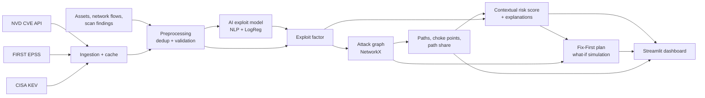

# 🛡️ VulnPrio AI

### AI-Based Vulnerability Prioritization & Attack-Path Analysis
*A context-aware approach to cybersecurity risk assessment and remediation*

> **"What should we fix first, and why?"**

Most teams patch by CVSS score. But a CVSS 9.8 bug on an isolated test box can matter far less than a
CVSS 7.5 bug on an internet-facing server one hop away from the customer database.
**VulnPrio AI** ranks vulnerabilities by *real-world context*: exploitation evidence, an AI exploit
predictor, asset importance, network exposure, and position on attack paths to critical systems.

B.Tech CSE final-year major project · PVPIT Budhgaon, Sangli · DBATU · 2026–27

---

## ✨ Features
- **Real threat intelligence:** NVD CVE API 2.0, FIRST EPSS, CISA KEV (cached, dated snapshots)
- **🤖 AI exploit predictor:** NLP model (TF-IDF + Logistic Regression) trained on 54k real CVEs to
  predict which ones get exploited
- **Contextual risk score (0–100)** from 5 transparent factors, with a plain-English reason for every finding
- **Attack graph:** NetworkX model of how an attacker could move from the Internet to crown-jewel assets
- **Most-likely attack paths**, **choke points** (minimum node cut) and **what-if fix simulation**
- **Graph-aware "Fix First" plan:** a greedy optimiser that picks the fixes that cut the most risk
- **Built-in evaluation** against a CVSS-only baseline
- **Interactive dashboard** (Streamlit): 7 tabs, live weight sliders, interactive graph, CSV upload/export
- Unit-tested with pytest

## 📈 Results so far
**AI model:** trained on CVEs from 2019–2020 and tested on 18,544 *unseen* CVEs from 2021 (202 later known exploited):

| Metric | AI model | CVSS-only |
|---|---|---|
| ROC-AUC | **0.841** | 0.719 |
| PR-AUC | **0.084** | 0.023 |
| Precision@100 | **18%** | 4% |

The remediation experiment on the synthetic network is in [docs/RESULTS.md](docs/RESULTS.md).
*Network results are simulation-based; see limitations in [docs/METHODOLOGY.md](docs/METHODOLOGY.md).*

## 🏗️ Architecture


## 🚀 Quick start
```bash
git clone https://github.com/Ahanti05/vulnprio-ai.git
cd vulnprio-ai
python3 -m venv .venv && source .venv/bin/activate
pip install -r requirements.txt
streamlit run app.py
```
The sample data and trained model are included, so the dashboard works offline straight away.

### Rebuild everything from live data (optional)
```bash
python scripts/build_ml_dataset.py --start 2019-01-01 --end 2021-12-07   # ~10 min, NVD rate limit
python scripts/train_model.py --split 2021-01-01
python scripts/fetch_intel.py --refresh        # live CVSS / EPSS / KEV for the sample findings
python scripts/evaluate.py                     # writes docs/RESULTS.md
pytest -q
```
Tip: set `NVD_API_KEY` (free from NVD) to download about 10× faster.

## 📁 Project structure
```
vulnprio/
  ingest/      nvd.py, epss.py, kev.py, enrich.py   - threat-intel collection
  loader.py    data loading, cleaning, validation
  scoring.py   contextual risk score + explanations
  graph.py     attack graph, paths, choke points, risk metrics
  remediation.py  what-if, greedy fix plan, strategy comparison
  ml/model.py  AI exploit-likelihood model
  analysis.py  end-to-end pipeline
app.py         Streamlit dashboard
scripts/       data download, training, evaluation
data/sample/   synthetic company network + CVE snapshot
models/        trained model + metrics
tests/         pytest unit tests
docs/          methodology and results
```

## 🔒 Ethics and scope
Defensive decision-support only. It never scans or exploits anything. The demo network is
**synthetic**, and real scanning should only be done on systems you own or are authorised to test.
A modelled attack path is a planning aid, not proof that an attack is possible.

## 🗺️ Roadmap
See [ROADMAP.md](ROADMAP.md): Semester 7 (80%, core system) and Semester 8 (20%, SHAP, scalability, ATT&CK, API, deployment, paper).

## 📚 Key references
- NIST NVD Vulnerability APIs: https://nvd.nist.gov/developers/vulnerabilities
- FIRST EPSS: https://www.first.org/epss/ · FIRST CVSS v4.0: https://www.first.org/cvss/
- CISA KEV: https://www.cisa.gov/known-exploited-vulnerabilities-catalog
- NetworkX: https://networkx.org · scikit-learn: https://scikit-learn.org
