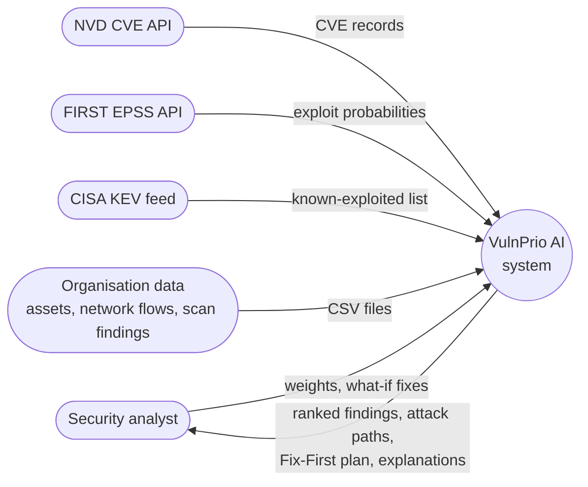
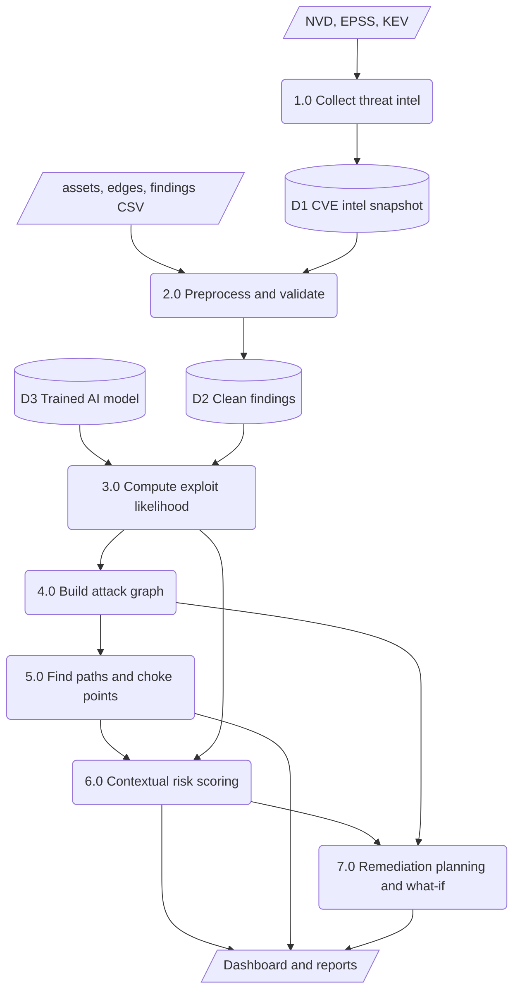
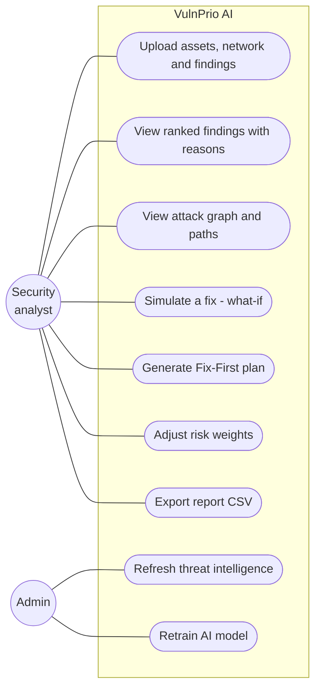
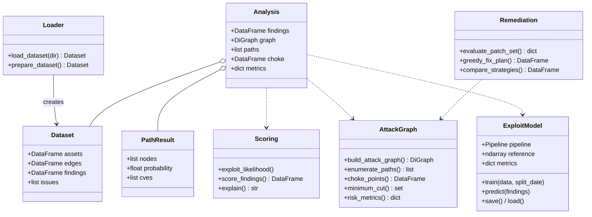
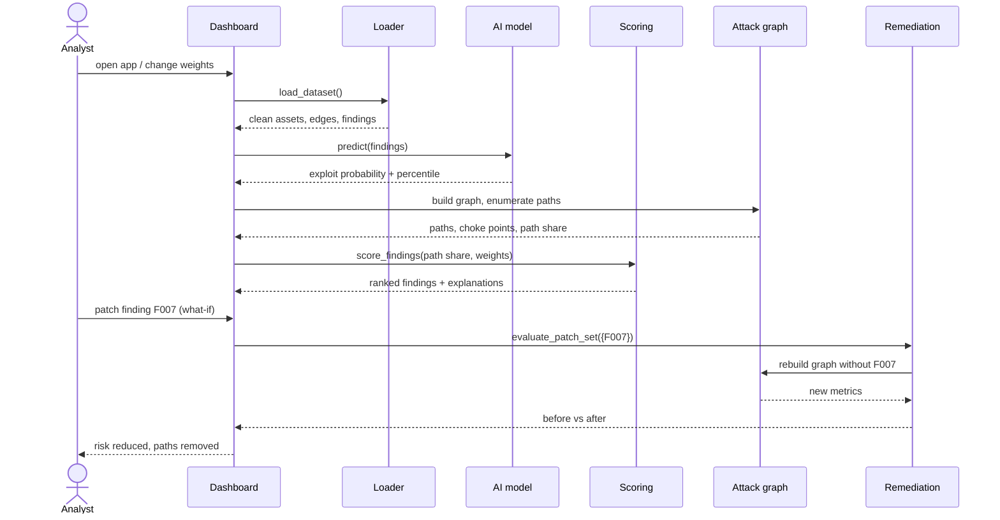
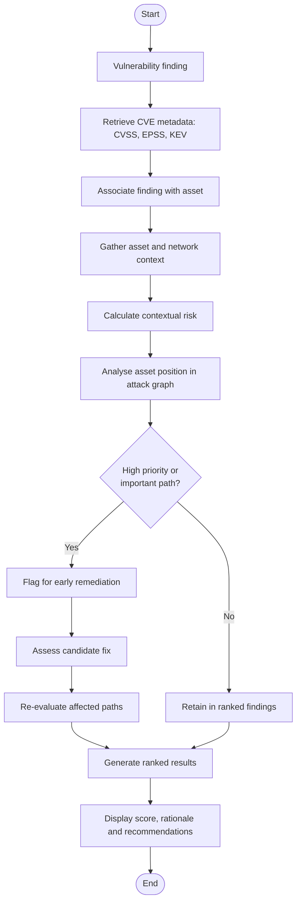
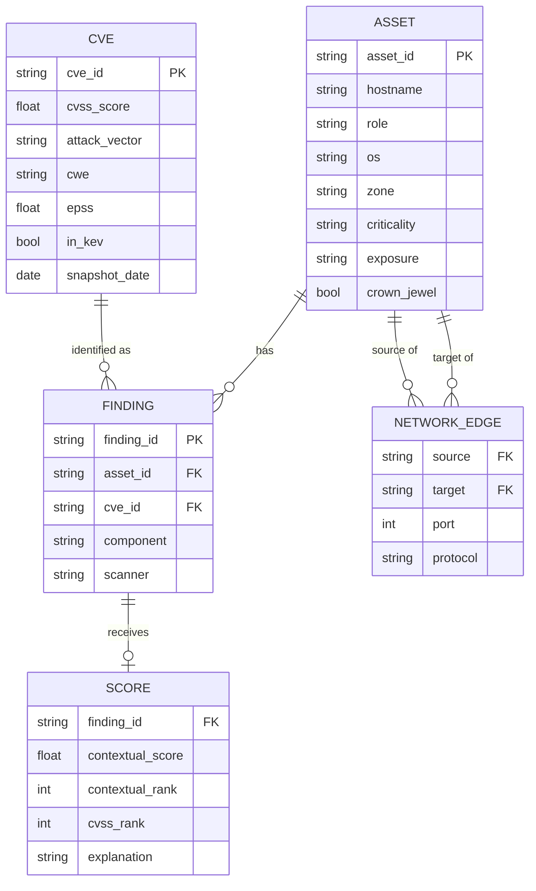

# System design diagrams

These diagrams render on GitHub. For the report, open each one in https://mermaid.live,
choose a plain black-and-white theme, and export as PNG/SVG.

---

## 1. DFD level 0 (context diagram)


## 2. DFD level 1


## 3. Use case diagram


## 4. Class diagram


## 5. Sequence diagram: analyst opens the dashboard


## 6. Activity diagram: risk assessment (matches synopsis §5.8)


## 7. ER diagram (data model)


## 8. Deployment diagram
```mermaid
flowchart LR
  subgraph User laptop / browser
    B[Web browser]
  end
  subgraph Server or laptop - Python 3.9+
    ST[Streamlit app<br/>app.py]
    CORE[vulnprio package<br/>scoring, graph, AI]
    FS[(CSV snapshots<br/>+ model.joblib)]
  end
  subgraph Internet - public APIs
    N[NVD API]
    E[EPSS API]
    K[CISA KEV JSON]
  end
  B -- HTTP :8501 --> ST
  ST --> CORE
  CORE --> FS
  CORE -. scripts/fetch_intel.py .-> N
  CORE -.-> E
  CORE -.-> K
```
